# Sprites — Combo Tactics

Pixel art medieval, vista lateral, olhando para a direita (o oponente usa o mesmo sprite espelhado).

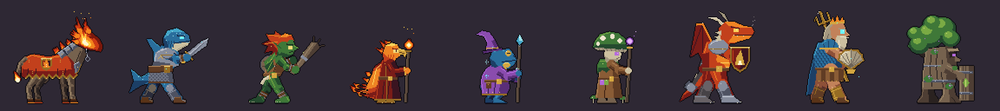

O elenco inteiro foi refeito (v2), com as cinco animações de cada personagem.

| Personagem | Parado | Ataque | Especial | Dano | Derrota |
| --- | --- | --- | --- | --- | --- |
| Guerreiro de Fogo | 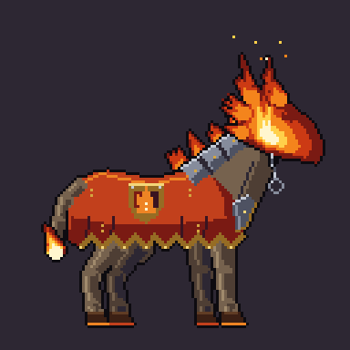 | 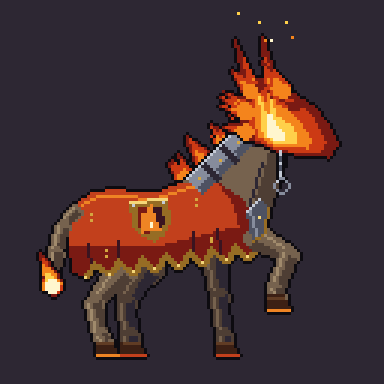 | 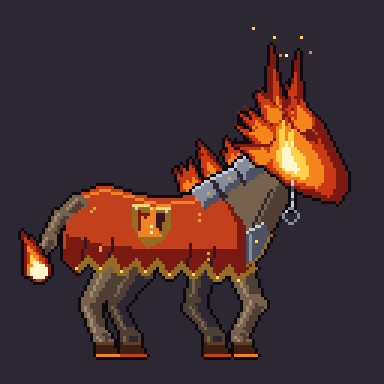 | 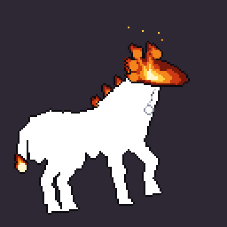 | 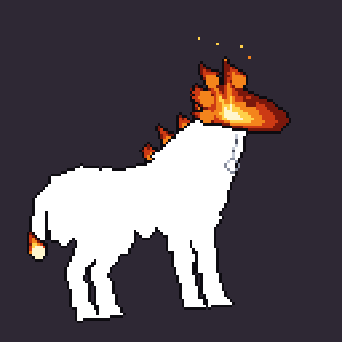 |
| Guerreiro de Água | 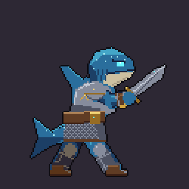 | 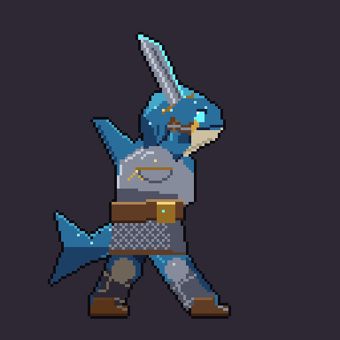 | 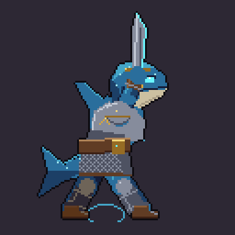 | 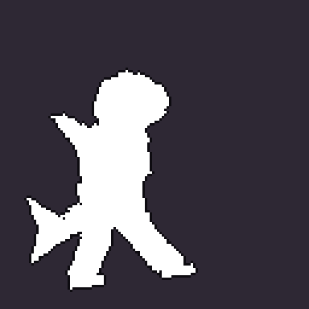 | 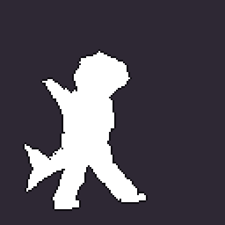 |
| Guerreiro de Planta | 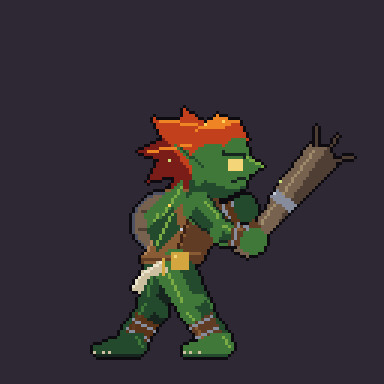 | 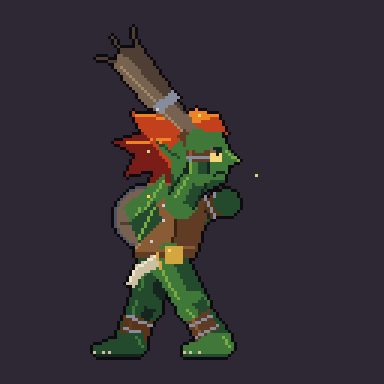 | 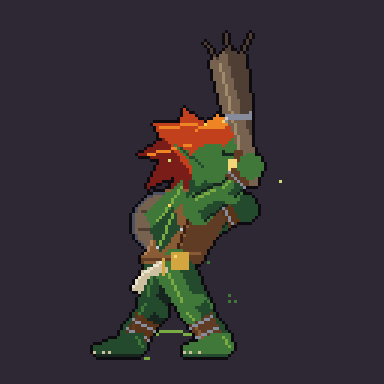 | 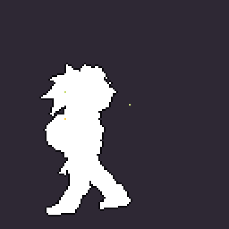 | 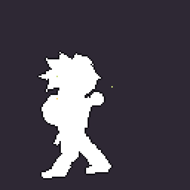 |
| Mago de Fogo | 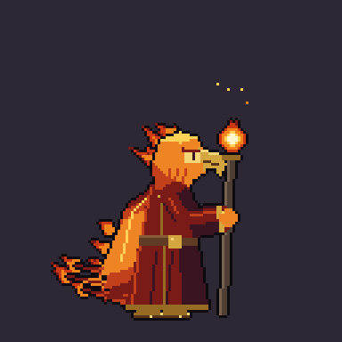 | 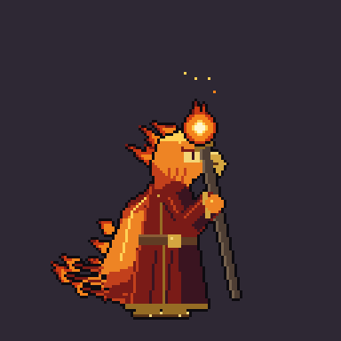 | 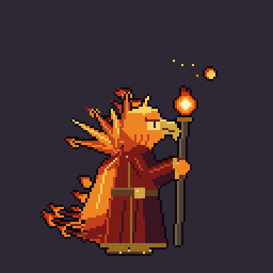 | 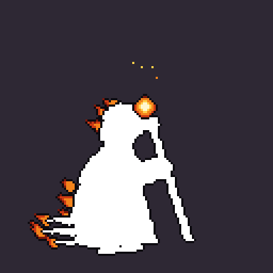 | 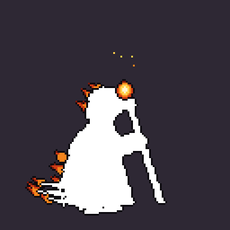 |
| Mago de Água | 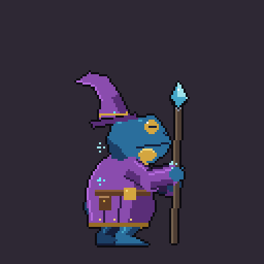 | 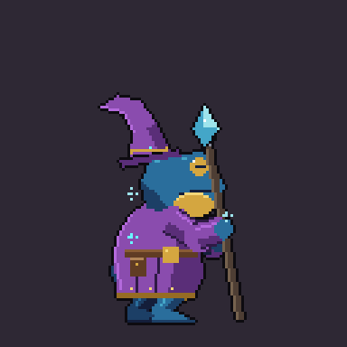 | 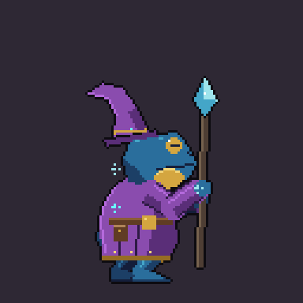 | 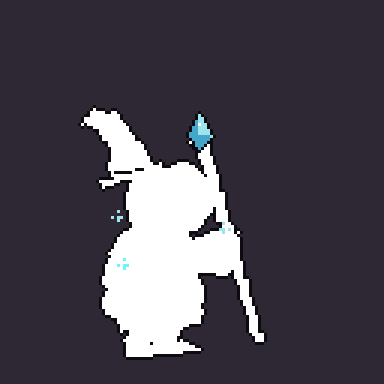 | 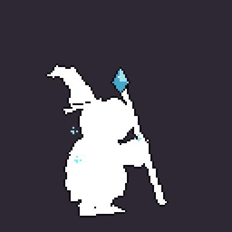 |
| Mago de Planta | 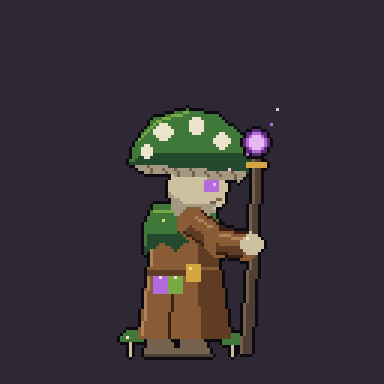 | 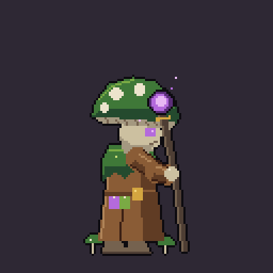 |  | 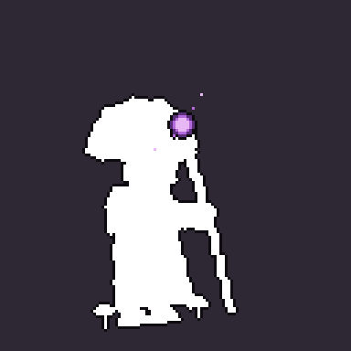 | 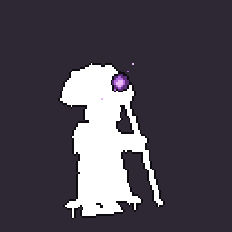 |
| Tanque de Fogo | 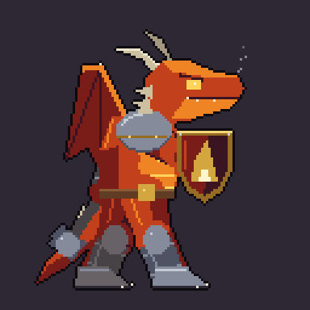 | 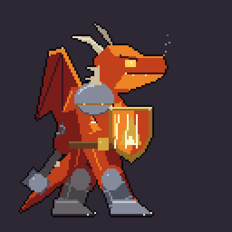 | 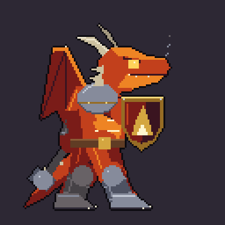 | 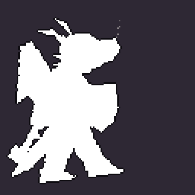 | 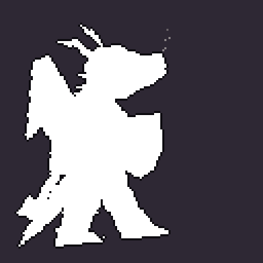 |
| Tanque de Água | 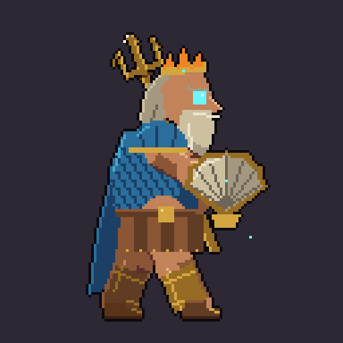 | 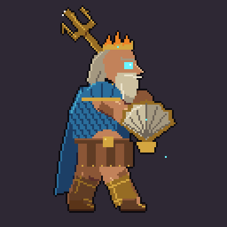 | 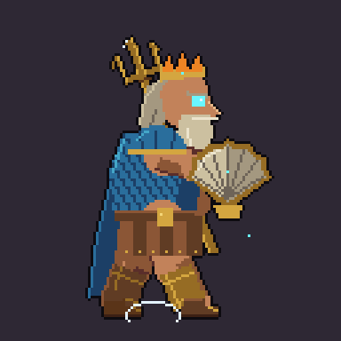 | 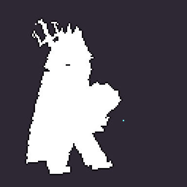 | 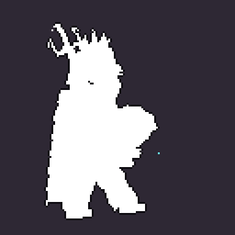 |
| Tanque de Planta | 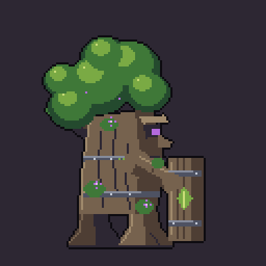 | 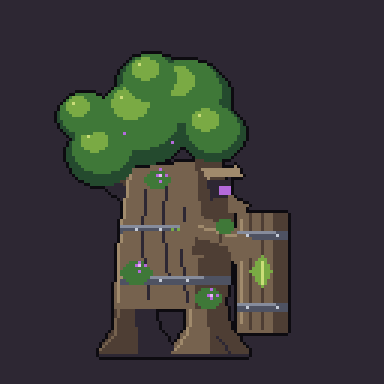 | 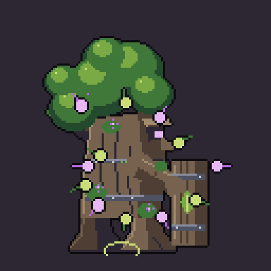 | 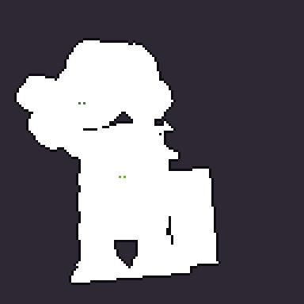 | 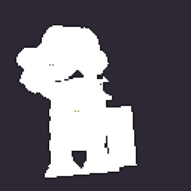 |

Quadros por animação: Parado 6 (6 fps, em loop), Ataque 6 (10 fps), Especial 8 (10 fps), Dano 3 (10 fps), Derrota 6 (8 fps). Em todos, o Dano é um flash branco com recuo, e a Derrota termina com o personagem se desfazendo em partículas do seu elemento.

## Personagens

- **Guerreiro de Fogo — Mula sem cabeça:** mula de guerra com uma chama em forma de cabeça de mula, freio de ferro arrebentado pendurado do colar (na lenda, arrancá-lo quebra o encanto), crina de fogo entre lamelas de ferro, caparazão carmesim, ferraduras em brasa e cauda em chamas.
  - **Ataque (Corte Flamejante):** empina e desce os cascos num arco de fogo em meia-lua.
  - **Especial (Investida Vulcânica):** baixa a cabeça, galopa deixando um rastro de fogo e explode diante do oponente.
  - **Derrota:** vira brasas e sobra uma brasa no chão.
- **Guerreiro de Água — Guerreiro-tubarão:** tubarão-baleia em guarda de esgrima, com peitoral de placas, saia de malha, barbatana e cauda.
  - **Ataque (Lâmina de Correnteza):** corte descendente com arco de água.
  - **Especial (Impacto Gêiser):** carrega água na falcata, crava no chão e um gêiser irrompe à frente.
- **Guerreiro de Planta — Curupira:** pequeno e ágil, com cabeleira de folhas vermelhas, pés virados para trás, clava de raiz, broquel nas costas, berrante e vagalumes.
  - **Ataque (Esmagamento com Raízes):** esmaga o chão e raízes brotam.
  - **Especial (Golpe Espinhoso):** folhas giram em volta, ele crava a clava e espinhos irrompem rumo ao oponente.
- **Mago de Fogo — Bruxo-fênix:** cabeça de ave de rapina com crista em chamas, asas como manto de penas em brasa, túnica carmesim e cajado com orbe de fogo.
  - **Ataque (Bola de Fogo):** carrega o orbe e lança a bola de fogo.
  - **Especial (Explosão Solar):** abre as asas, forma um sol e o explode em raios.
  - **Derrota:** vira cinzas e sobra a brasa de onde a fênix renasce.
- **Mago de Água — Sapo mago:** curvado sobre o cajado de cristal de gelo, com chapéu pontudo, papo que infla e manto roxo.
  - **Ataque (Jato de Pressão):** enche o papo e dispara um jato de água.
  - **Especial (Prisão Gélida):** bate o cajado no chão e um bloco de gelo prende o oponente.
- **Mago de Planta — Cogumelo:** chapéu inclinado como capuz, rosto sob a aba, capa de musgo e cajado com orbe de esporos.
  - **Ataque (Chicote de Vinhas):** uma vinha espinhosa chicoteia o oponente.
  - **Especial (Esporos Tóxicos):** solta uma nuvem de esporos roxos.
- **Tanque de Fogo — Dragão:** cavaleiro-dragão com escudo de brasão de chama, maça, peito em brasa, asas, fumaça nas narinas e cauda com espinhos.
  - **Ataque (Escudo de Magma):** o escudo esquenta até virar magma e ele investe espirrando lava.
  - **Especial (Provocação Ardente):** abre as asas e ruge cuspindo fogo, com chamas subindo do chão.
- **Tanque de Água — Poseidon:** rei do mar em armadura de escamas, com escudo de concha, tridente, barba de espuma e coroa de coral.
  - **Ataque (Barreira Hidráulica):** baixa o tridente e uma onda quebra sobre o oponente.
  - **Especial (Carapaça de Gelo):** uma armadura de cristais de gelo o envolve.
- **Tanque de Planta — Árvore:** árvore guardiã com rosto entalhado, copa de folhas, escudo de tábuas, raízes, musgo e flores roxas.
  - **Ataque (Muralha de Troncos):** crava o escudo e troncos com cintas de ferro brotam à frente.
  - **Especial (Absorção Vital):** puxa partículas de vida para o tronco.

## Como importar na Unity

- Importe com PPU 96, Filter Mode Point, sem compressão e sem mipmaps, usando o pivô do `_sheet.json`. Cada sheet tem uma linha por animação, na ordem do JSON.
